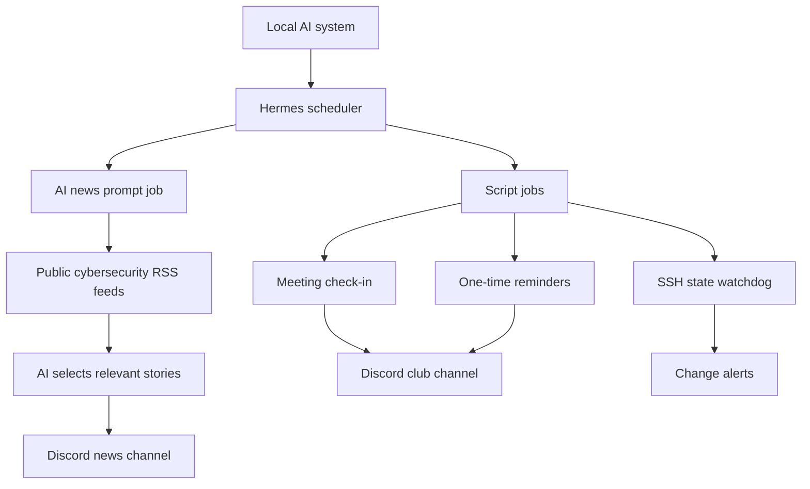

# Architecture

This repository documents how the club's local AI setup supports Discord automation without exposing its private infrastructure configuration.

## Scheduled work

| Job | Scheduled behavior | Job type |
| --- | --- | --- |
| Daily security digest | Every day at 8:00 AM | AI agent prompt |
| Club meeting check-in | Wednesday at 12:10 PM | Bash script |
| SSH watchdog | Every 5 minutes | Bash script |
| One-time reminders and poll tests | Run only as needed | Bash script |

Schedules reflect the documented club setup; each deployment needs its own timezone and scheduler configuration.

## How messages get delivered

- **Agent job:** Hermes runs the news prompt, uses available feed-reading tools, then posts the agent's final digest to Discord.
- **Script job:** Hermes runs a shell script and can deliver its standard output as a message. Scripts should emit no output if there is nothing to report.
- **Meeting reactions:** The meeting script calls the Discord REST API to send a message and add reaction emojis.
- **SSH watchdog:** The script remembers its previous state and only reports when that state changes.

## Public/private boundary

The real Hermes profile, bot credentials, actual channel identifiers, host addresses, and operational logs stay private. This repository uses generic names and placeholders. See [setup.md](setup.md).
